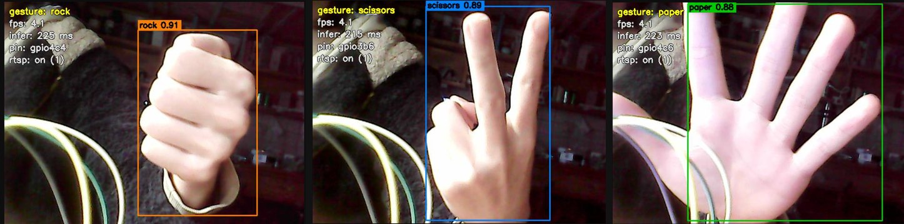
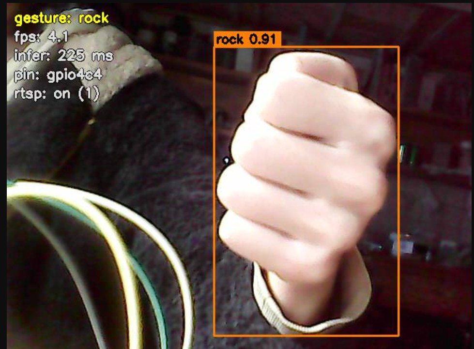
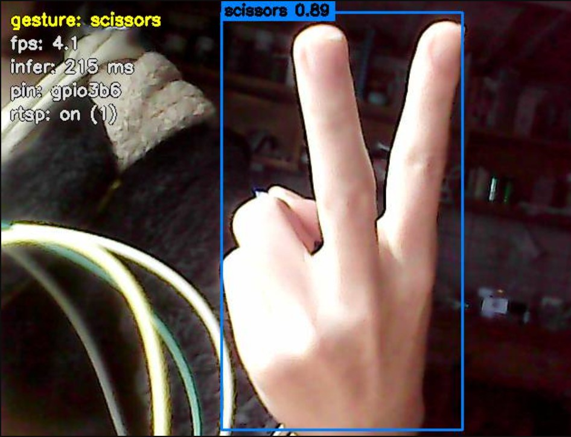
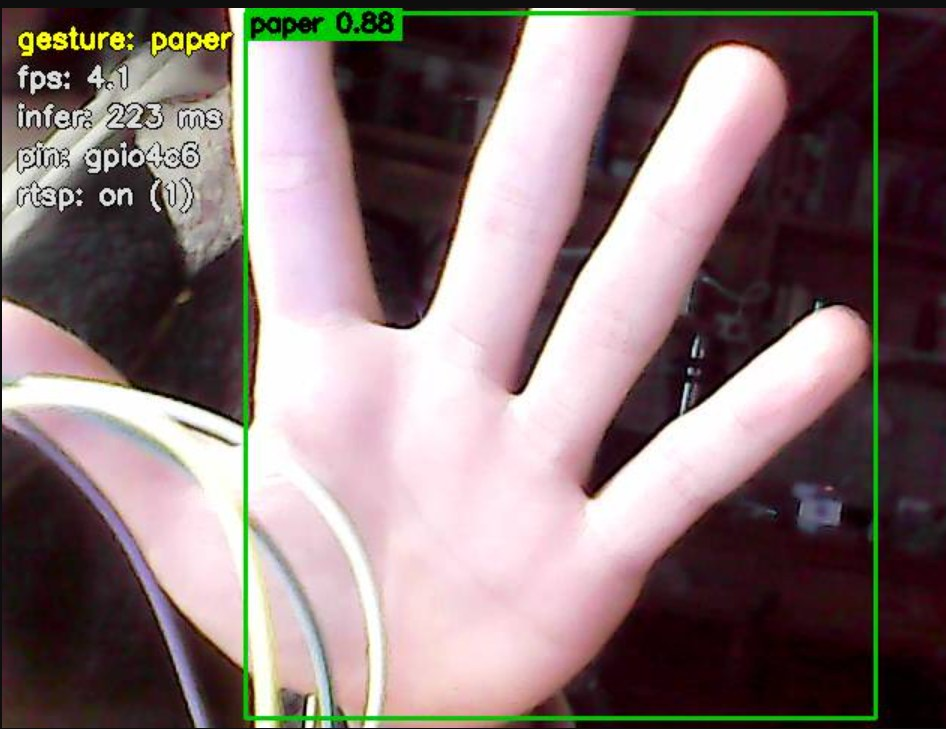

# RK3568 手势识别 → 引脚控制



在 **KICKPI K1 MINI（RK3568）** 上用 YOLO 实时识别「石头 / 剪刀 / 布」，
把识别结果输出到扩展引脚上驱动 LED，并提供**网页实时预览**与 **RTSP 推流**。

```
USB 摄像头 → YOLO(ONNX, CPU) → 手势 → 时间平滑 → 三个扩展引脚输出
                                    ↘ 网页 MJPEG / RTSP 推流
```

## 效果

- 识别到某个手势 → 对应引脚输出 **1**，其余两个 **0**
- 没识别到 → **全部 0**
- 电脑浏览器可实时看到带检测框的画面，VLC 也能拉 RTSP 流

| ✊ rock → `gpio4c4`（Pin27） | ✌️ scissors → `gpio3b6`（Pin32） | ✋ paper → `gpio4c6`（Pin25） |
| :---: | :---: | :---: |
|  |  |  |

> 截图为实际运行画面：左上角是手势、帧率、推理耗时、当前输出引脚和 RTSP 状态，
> 框上的数字是置信度。三张图都是通过 VLC 拉流截的（`rtsp: on`），说明推流同时在跑。

| 手势 | 40Pin | GPIO | 输出引脚（LED 节点） |
| --- | --- | --- | --- |
| ✊ rock | Pin27 | GPIO4_C4 | `gpio4c4` |
| ✋ paper | Pin25 | GPIO4_C6 | `gpio4c6` |
| ✌️ scissors | Pin32 | GPIO3_B6 | `gpio3b6` |

> 这三个脚在出厂设备树里已被注册成 LED 节点，所以走
> `/sys/class/leds/<名字>/brightness` 控制，**不需要改设备树、不需要重编内核**。

## 硬件要求

| 项 | 要求 |
| --- | --- |
| 开发板 | KICKPI K1 MINI（RK3568B2，4×A55 @2.0GHz） |
| 系统 | Ubuntu 20.04（出厂镜像） |
| 摄像头 | 任意 UVC 摄像头，本仓库默认 `/dev/video10` |
| 负载 | 3 个 LED + 限流电阻（220Ω 左右）接上述三个引脚与 GND |

### ⚠️ 电压域：选错引脚会点不亮

RK3568 有 7 个 VCCIO 电压域，**同一块板上不同引脚电压不同**：

| LED 节点 | 40Pin | 电压域 | 电压 | 能否驱动 3.3V LED |
| --- | --- | --- | --- | --- |
| `gpio3b5` | Pin29 | VCCIO5 | 3.3 V | ✅ |
| `gpio3b6` | Pin32 | VCCIO5 | 3.3 V | ✅ |
| `gpio4c4` | Pin27 | VCCIO7 | 3.3 V | ✅ |
| `gpio4c6` | Pin25 | VCCIO7 | 3.3 V | ✅ |
| `gpio1a4` / `gpio1b0` / `gpio1b1` / `gpio1b2` | Pin7/11/13/15 | VCCIO1 | 3.0 V | ✅ |
| `gpio1d0` | **Pin36** | VCCIO2 | **1.8 V** | ❌ 很暗 |
| `gpio1d4` | **Pin38** | VCCIO2 | **1.8 V** | ❌ 不亮 |

`VCCIO2` 由 `VCCIO_FLASH` 供电、同时供给 **eMMC 的 I/O**，是 1.8V 域。
普通 LED 的 Vf≈1.8~2.1V，1.8V 驱动时几乎不导通。
**不要把 VCCIO2 改成 3.3V——会烧 eMMC。**

详细分析见 [docs/引脚电压域分析.md](docs/引脚电压域分析.md)。

## 快速开始

### 1. 装依赖

```bash
# 运行必需（板上一般已有 cv2 和 numpy）
pip3 install --user onnxruntime==1.16.3     # 老版 pip 装不了 1.17+，见 FAQ

# 检查
python3 -c "import cv2, numpy, onnxruntime; print('ok')"
```

### 2. 放开 LED 写权限（只需一次）

```bash
bash setup_permissions.sh
```

装一条 udev 规则，让普通用户也能写 `/sys/class/leds/*/brightness`，之后不用 sudo。

### 3. 自检

```bash
python3 tests/test_camera.py      # 摄像头能出图
python3 tests/test_led.py         # 三个引脚能亮灭
python3 tests/test_mapping.py     # 手势名 -> 引脚 映射正确
python3 tests/test_image.py       # 从摄像头抓一帧跑一次推理
```

### 4. 运行

```bash
./run.sh                    # 默认开网页预览
./run.sh --debug            # 打印每帧推理耗时与检测结果
./run.sh --frames 300       # 跑 300 帧后退出（测帧率）
```

启动后会打印：

```
  ╔══════════════════════════════════════════════╗
  ║  实时预览已启动                               ║
  ╚══════════════════════════════════════════════╝
   在电脑浏览器打开：  http://192.168.1.50:8080/
```

## 三种观察方式

### ① 网页预览（最简单）

浏览器打开 `http://<板子IP>:8080/`，画面带检测框、手势、帧率、引脚状态。

| 端点 | 内容 |
| --- | --- |
| `/` | 网页（视频 + 状态栏） |
| `/stream` | 纯 MJPEG 流 |
| `/snapshot` | 单张 JPEG |
| `/stats` | JSON 状态 |

### ② RTSP 推流（VLC / 手机 / 录像）

需要一个 RTSP 服务器，推荐 [MediaMTX](https://github.com/bluenviron/mediamtx)（单文件，免安装）。

```bash
# Windows 上先跑 mediamtx.exe（默认监听 8554）
./run.sh --rtsp rtsp://192.168.1.100:8554/hand
```

然后任意设备用 VLC 打开 `rtsp://192.168.1.100:8554/hand`：

```bash
# 录像
ffmpeg -rtsp_transport tcp -i rtsp://192.168.1.100:8554/hand -c copy out.mp4
```

实测：H.264 Constrained Baseline / 640×480 / 8 fps 上限 / 约 2 Mbps，
编码开销约 23ms/帧（独立线程，不拖慢推理）。

也可以写进 `config.json` 的 `rtsp` 段，之后 `./run.sh` 直接推流。

> **⚠️ 端口一定要写清楚。**
> RTSP 的标准默认端口是 **554**，而 MediaMTX 默认监听 **8554**。
> 写成 `rtsp://192.168.1.100/hand` 会去连 `:554`，连不上，
> 于是服务器上根本没有这条流，VLC 只会报
> `no stream is available on path 'hand'`——看起来像是 VLC 的问题，其实是没推上去。
> 程序启动时会检查端口并在缺失时给出提示。

### ③ 静态图验证

```bash
python3 tests/test_image.py                # 摄像头抓一帧
python3 tests/test_image.py my_photo.jpg   # 指定图片
```

结果图存到 `out_img/`。

## 配置

所有参数在 `config.json`：

| 字段 | 说明 |
| --- | --- |
| `camera.device` | 摄像头节点，默认 `/dev/video10` |
| `camera.use_mjpg` | **必须 true**。USB2.0 带宽下 YUYV 只有几帧 |
| `model.path` | ONNX 模型路径 |
| `model.input_size` | 320 最快；480/640 更准但更慢 |
| `model.conf_thres` | 置信度阈值，误检多就调到 0.5~0.6 |
| `model.class_names` | **顺序必须与 `models/labels.txt` 一致** |
| `gesture_to_led` | 手势 → LED 节点名 |
| `behavior.stable_frames` | 连续多少帧同手势才切换（去抖） |
| `behavior.no_gesture_frames` | 连续多少帧无手势才关灯 |
| `preview` | 网页预览：端口、JPEG 质量、推流帧率上限 |
| `rtsp` | RTSP：url、fps、码率、是否烧检测框 |

## 目录结构

```
rk3568_gesture_demo/
├── main.py                 # 主程序：取帧 → 推理 → 平滑 → 输出引脚
├── yolo_onnx.py            # YOLO ONNX 推理封装（letterbox / 解码 / NMS）
├── preview.py              # 网页 MJPEG 推流 + 画框
├── rtsp.py                 # RTSP 推流（ffmpeg + 独立编码线程）
├── led_out.py              # 手势 → 引脚 映射
├── config.json             # 全部参数
├── run.sh                  # 一键启动
├── setup_permissions.sh    # udev 规则，免 sudo 写 LED
├── requirements.txt
├── models/
│   ├── hand_gesture.onnx   # yolo11n 导出的 ONNX（10 MB）
│   └── labels.txt          # Paper / Rock / Scissors
├── tests/
│   ├── test_camera.py
│   ├── test_led.py
│   ├── test_mapping.py
│   └── test_image.py
├── scripts/
│   └── export_onnx.py      # .pt → ONNX（换模型时才用）
└── docs/
    ├── 项目复盘.md          # 开发过程、踩坑记录、方法论
    ├── 引脚电压域分析.md
    └── screenshots/         # README 用的效果图
```

## 工作流程

```
/dev/videoXX (MJPG 640x480)
        │ cv2.VideoCapture
        ▼
   letterbox 到 320x320，BGR→RGB，/255
        ▼
   onnxruntime 推理（cpu，4 线程）
        │ 输出 (1, 7, 8400) = 4 坐标 + 3 类别
        ▼
   argmax 类别 + 阈值过滤 + NMS + 坐标还原
        ▼
   取置信度最高的框 → 手势名
        ▼
   连续 stable_frames 帧一致才生效（去抖）
        ▼
   /sys/class/leds/<pin>/brightness 写 1/0
```

### 为什么要时间平滑

单帧检测会抖（光照、运动模糊、置信度在阈值附近浮动）。
`stable_frames: 5` 表示连续 5 帧同手势才切换，`no_gesture_frames: 10` 表示
连续 10 帧无手势才关灯。数值越大越稳，但响应越慢。

### 为什么预览几乎不占 CPU

主循环只做一次 `preview.update(frame)`（拷贝一帧，约 1ms）。
**画框和 JPEG 编码都在 HTTP 服务线程里，且只在有客户端时才做。**
没人看的时候开销接近 0。

## 实测性能

| 项 | 数值 |
| --- | --- |
| 推理（yolo11n @320，CPU 4 线程） | ≈ 170 ms |
| 端到端帧率 | ≈ 4~5 fps |
| 网页推流额外开销 | 可忽略（4.6 vs 4.3 fps） |
| RTSP 编码开销 | ≈ 23 ms/帧（独立线程） |
| 温度 | ≈ 55~60 °C |

## 模型

仓库自带的 `models/hand_gesture.onnx` 来自
[`Gholamreza/yolo11_rock_paper_scissors_detection`](https://huggingface.co/Gholamreza/yolo11_rock_paper_scissors_detection)
的 `yolo11n` 权重，导出为 320×320 固定输入。

换成自己训练的模型：

```bash
pip install torch ultralytics
python3 scripts/export_onnx.py path/to/best.pt
# 然后按新模型的类别改 config.json 的 class_names
```

## FAQ

**Q: `pip install onnxruntime` 说没有可用版本**
老版本 pip（如 Ubuntu 20.04 的 20.0.2）认不出 `manylinux_2_28` 标签，
会过滤掉新轮子。装 `onnxruntime==1.16.3`，或先升级 pip：
```bash
python3 -m pip install --user --upgrade pip
```

**Q: 写 brightness 报 Permission denied**
跑一次 `bash setup_permissions.sh`。`run.sh` 检测到不可写会自动降级用 sudo。

**Q: sudo 下 `ModuleNotFoundError: onnxruntime`**
`pip --user` 装的包 root 看不到。`run.sh` 已经处理；
手动跑时要带 `PYTHONPATH=$HOME/.local/lib/python3.8/site-packages`。

**Q: 帧率突然掉到 2fps 以下**
先看有没有后台任务偷 CPU：
```bash
ps -eo pid,pcpu,comm,args --sort=-pcpu | head -6
```
本项目实测踩过：**`unattended-upgrade`（Ubuntu 自动更新）吃满一个核**，
推理从 170ms 掉到 400ms。关掉它：
```bash
sudo systemctl disable --now unattended-upgrades
sudo systemctl disable --now apt-daily.timer apt-daily-upgrade.timer
```

**Q: 识别不准**
- 光照不足 → 补光
- 手太远 → 让手占画面 1/3 以上
- 角度问题 → 手掌朝向摄像头
- 类别名对不上 → `cat models/labels.txt` 核对

**Q: 某个引脚点不亮**
多半是电压域选错，见上文「电压域」表格。

## 已知限制

- **CPU 推理**，没用上 NPU。RKNN 转换工具 `rknn-toolkit2` 只支持 x86_64 Linux，
  需要在 x86 机器上把 ONNX 转成 `.rknn` 再拷回来。转换后预期 20ms 级。
- **RTSP 用软件 x264**。板上 ffmpeg 未编译 rkmpp，`h264_v4l2m2m` 也不可用，
  硬件 VPU 编码没走通。
- 只跟踪置信度最高的一个手势框，不支持双手同时识别。

## 致谢

- 模型权重：[Gholamreza/yolo11_rock_paper_scissors_detection](https://huggingface.co/Gholamreza/yolo11_rock_paper_scissors_detection)
- 推理框架：[ONNX Runtime](https://onnxruntime.ai/)
- RTSP 服务器：[MediaMTX](https://github.com/bluenviron/mediamtx)

## License

仅供学习交流使用。第三方模型权重请遵循其原始许可。